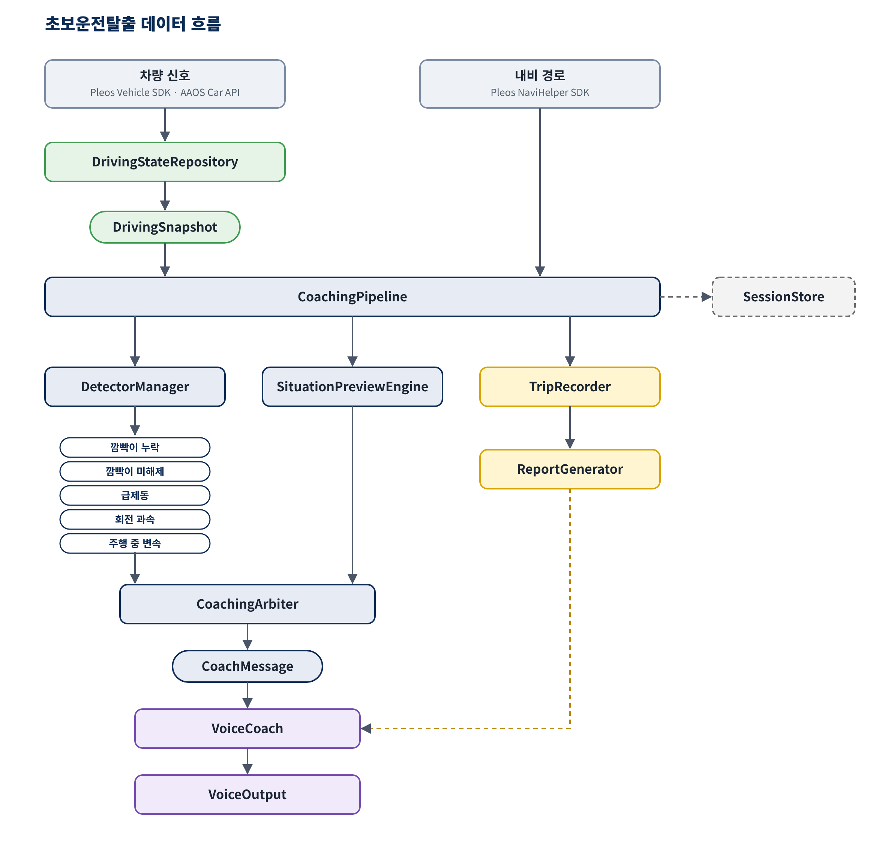

# 초보운전탈출 (Pleos Side-Coach)

초보운전자 옆자리에 연수 강사가 앉아 있는 것처럼, 차량 신호와 내비 경로를 읽고 **지금 무엇을 해야 하는지 음성으로 알려주는** Pleos Connect(AAOS) 앱이다.
현대자동차그룹 차량용 앱 개발 공모전 출품작.

## 주요 기능

| 기능 | 언제 | 하는 일 |
|---|---|---|
| 실시간 조작 코칭 | 주행 중, 음성 | 깜빡이 누락, 깜빡이 끄기 잊음, 급제동, 회전 과속, 움직이는 중 기어 변경을 그 자리에서 교정하고, 깜빡이를 잘 켜면 칭찬 |
| 상황 예고 | 주행 중, 음성 | 내비 경로를 보고 회전 전 차로 준비, 연속 회전, 회전교차로 같은 통행 규칙을 미리 안내. 운전자가 지금 차로를 알려주면 차로 기준으로 단정해서 안내 |
| 주차 코치 | 후진 중, 음성 | 후진·평행 주차를 기준점과 함께 단계별로 안내하고 핸들 각도를 확인 |
| 성적표 | 주행 후 | 점수, 등급, 항목별 기록과 다음 연습 과제 |
| 차량 기능 도움말 | 정차 중 | 김 서림 제거, 회생제동 같은 버튼 사용법을 그림과 음성으로 |
| Gleo 음성 명령 | 언제나 | 코칭 시작, 지금 차로 알려주기, 차량 기능 질문 |

주행 중에는 음성만 쓰고, 화면 조작은 정차 중에만 한다. 자세한 기획은 [docs/concept.md](docs/concept.md).

## 데이터 흐름



차량 신호는 스냅샷으로, 내비 경로는 안내 지점 목록으로 `CoachingPipeline`에 들어온다. 파이프라인이 디텍터, 상황 예고, 주행 기록에 나눠 주고, `CoachingArbiter`가 지금 말할 메시지 하나를 골라 `VoiceCoach`가 말한다. 패키지별 책임은 [docs/architecture.md](docs/architecture.md).

## 기술 구성

- Kotlin, Jetpack Compose, Coroutines·Flow
- Pleos Vehicle SDK 2.3.2 (조향·깜빡이·브레이크), Pleos NaviHelper SDK 3.0.5 (경로 회전 목록)
- AAOS CarPropertyManager (기어·차속), CarUxRestrictionsManager (주행 규제)
- Gleo 음성 명령 (`assets/schema.json`), Foreground Service
- minSdk 28, targetSdk 37

## APK

- release APK: [apk/정인준_초보운전탈출_release.apk](apk/정인준_초보운전탈출_release.apk)

## 테스트 환경

- Pleos Connect 에뮬레이터 v2.1.0 (Android 14, API 34)
- 화면 규격: 2560 × 1440, 160dpi (가로)
- 에뮬레이터는 **Cold boot**로 켠다. Quick boot로 켜면 차량 신호(VHAL)가 동작하지 않는다.
- 차량 신호는 Virtual Console(`adb forward tcp:8088 tcp:8088` 후 `http://127.0.0.1:8088`)로 조작한다.
- 처음 실행할 때 나오는 위치 정보 권한을 허용한다. 차속을 읽는 권한이 위치 권한 그룹에 묶여 있다.

## 실행 방법

APK로 바로 설치:

```bash
adb install apk/정인준_초보운전탈출_release.apk
```

설치 후 앱 목록에서 **초보운전탈출**을 실행한다. 기어를 D로 바꾸고 Virtual Console로 주행하면 코칭 음성이 나온다.

소스에서 빌드:

- 요구 사항: Android Studio
- Pleos SDK는 `nexus-playground.pleos.ai` 저장소에서 받는다 (`settings.gradle.kts`에 등록됨)

```bash
./gradlew assembleDebug          # APK 빌드
./gradlew installDebug           # 에뮬레이터에 설치
./gradlew testDebugUnitTest      # 단위 테스트
```

release 빌드(`./gradlew assembleRelease`)는 루트에 `keystore.properties`(storeFile, storePassword, keyAlias, keyPassword)가 있을 때만 서명된다.

에뮬레이터 준비, 차량 신호 조작, 시연 방법은 [docs/test-guide.md](docs/test-guide.md)에 있다.

## 어디서 무엇을 보나

| 보고 싶은 것 | 위치 |
|---|---|
| 무엇을 왜 만드는지 | [docs/concept.md](docs/concept.md) |
| 코드 구조와 각 패키지의 책임 | [docs/architecture.md](docs/architecture.md) |
| 에뮬레이터로 테스트·시연하는 법 | [docs/test-guide.md](docs/test-guide.md) |
| 앱 코드 | `app/src/main/java/com/jij6303/sidecoach/` |
| 패키지 구조 | `data`(SDK 연결) → `state`(상태 묶기) → `feature`(코칭·주차·성적표·도움말) → `voice`(음성 출력), 시작과 연결은 `app` |
| 단위 테스트 | `app/src/test/java/com/jij6303/sidecoach/` |
| 녹음 음성 클립 | `app/src/main/res/raw/` |
| Gleo 음성 명령 정의 | `app/src/main/assets/schema.json` |
| 권한, 서비스, Gleo 명령 수신 설정 | `app/src/main/AndroidManifest.xml` |
