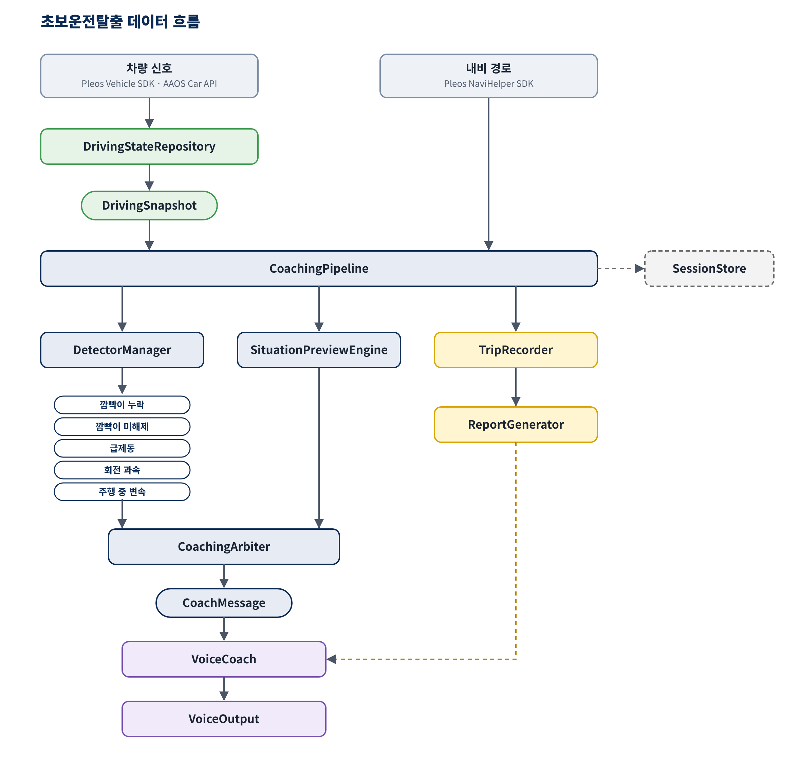

# 코드 구조

코드는 `app/src/main/java/com/jij6303/sidecoach/` 아래에 있고, **패키지 이름만 보고 책임을 알 수 있게** 나뉘어 있다.

## 1. 패키지와 책임

```
sidecoach/
├─ data/        SDK 연결
├─ state/       상태 분석·전처리
├─ feature/     기능별 구현
│  ├─ coach/      실시간 코칭 + 상황 예고
│  ├─ parking/    주차 코치
│  ├─ report/     주행 기록과 성적표
│  └─ tips/       차량 기능 도움말
├─ app/         진입점
├─ voice/       음성 출력
└─ ui/          공통: 테마, 여러 화면이 쓰는 타일
```

| 패키지 | 책임 | 주요 클래스 |
|---|---|---|
| `data/vehicle` | 차량 신호 구독 | `VehicleDataSource`(인터페이스), `PleosVehicleDataSource`(조향·깜빡이·브레이크), `AaosPropertyDataSource`(기어·차속), `FakeVehicleDataSource` |
| `data/navi` | 내비 경로 구독. 경로(안내 지점 목록)만 보내고 남은 거리는 계산하지 않는다 | `NaviEventSource`(인터페이스), `PleosNaviEventSource`(NaviHelper 회전 목록 → 경로), `FakeRouteNaviEventSource`(시연 경로), `RoutingNaviEventSource`(실제 경로가 없으면 시연 경로), `TbtMapping`(회전 종류 → 상황, 구간 거리 → 지점 위치) |
| `data/ux` | 주행 규제 구독 | `UxRestrictionSource`(인터페이스), `AaosUxRestrictionSource`, `FakeUxRestrictionSource` |
| `state` | 신호를 판단하기 좋은 형태로 묶기 | `DrivingSnapshot`(한 시점의 차량 상태), `DrivingStateRepository`(신호 → 스냅샷 흐름), `UxModeController`(규제 + 기어 → 화면 모드), `lane/CurrentLaneTracker`(지금 차로 추적) |
| `feature/coach` | 무엇을 언제 말할지 | `CoachingPipeline`(스냅샷·내비 경로를 받아 담당에게 나눠 주는 조율자), `detect/DetectorManager`(디텍터 5종 실행, 판정 결과와 교정·칭찬 후보), `detect/*Detector`(코칭 판정), `situation/SituationPreviewEngine`(상황 예고 후보), `situation/RouteProgress`(차속 적분으로 경로 위치·남은 거리), `CoachingArbiter`(우선순위·간격으로 하나 고르기), `CoachMessage`(말할 메시지), `lane/LaneInput`(차로 입력), `ui/DrivingScreen`. 음성 문구는 `CoachMessage.kt`의 `MessageCatalog`, 녹음 클립은 `res/raw/` |
| `feature/parking` | 주차 절차 코치 | `ParkingProcedure`(단계 정의), `ParkingCoachEngine`(단계 진행 판정), `ParkingCoachController`, `ParkingSettings`, `ui/ParkingPanel` |
| `feature/report` | 주행 기록과 성적표 | `trip/TripRecorder`(주행 구분과 통계, 주행이 끝나면 성적표 요청), `trip/TripSession`(주행 시작·이어가기·끝), `ReportGenerator`(점수·과제, 성적표 보관, 요약 음성), `ui/ReportScreen` |
| `feature/tips` | 차량 기능 도움말 | `CarTip`(도움말 목록), `CarTipSpeaker`, `ui/CarTipsScreen` |
| `app` | 앱이 시작되는 곳 | `SideCoachApp`(Application), `MainActivity`(화면 전환), `CoachingService`(Foreground Service), `di/ServiceLocator`(객체 생성·연결), `session/SessionStore`(세션 저장·복원), `gleo/`(Gleo 명령 처리, 명령 이름은 `assets/schema.json`과 같아야 함), `dashboard/`(정차 화면) |
| `voice` | 메시지를 소리로 내기 | `VoiceCoach`(오디오 포커스·대기열), `VoiceOutput`(인터페이스), `ClipVoiceOutput`(녹음 클립 우선), `AndroidTtsVoiceOutput`, `AudioFocusController` |
| `ui` | 공통 화면 요소 | `theme/`(색·글꼴), `components/`(타일·칩) |

**의존 방향**: `app` → `feature` → `state` → `data`. `voice`는 기능들이 만든 `CoachMessage`를 받아 소리로 낸다. 여러 화면이 쓰는 요소는 `ui`에 둔다.

`feature`끼리의 연결은 두 가지다.
- 모든 기능이 `feature/coach`의 `CoachMessage`로 말한다. 주차 안내, 성적표 요약, 도움말 답변도 같은 메시지 형식으로 음성 출력에 들어간다.
- `CoachingPipeline`이 주행 기록(`feature/report`의 `TripRecorder`)에 스냅샷과 판정 결과를 넘긴다. 코칭 판정과 통계가 같은 스냅샷을 같은 순서로 봐야 하기 때문이다.

## 2. 데이터 흐름



1. **차량 신호**(Pleos Vehicle SDK, AAOS Car API)를 `DrivingStateRepository`가 합쳐 `DrivingSnapshot` 하나로 만든다.
2. **내비 경로**(Pleos NaviHelper SDK)는 안내 지점 목록으로 `CoachingPipeline`에 바로 들어온다. 내비 경로가 없으면 시연 경로가 들어온다.
3. `CoachingPipeline`이 스냅샷과 내비 경로를 한 흐름으로 받아 세 담당에게 나눠 준다.
   - `DetectorManager`: 디텍터 5종(깜빡이 누락, 깜빡이 미해제, 급제동, 회전 과속, 주행 중 변속)을 돌려 교정·칭찬 후보를 만든다.
   - `SituationPreviewEngine`: 스냅샷 차속으로 경로 위 남은 거리를 재고, 예고 구간에 들어온 지점의 예고 후보를 만든다.
   - `TripRecorder`: 주행 시작·끝을 나누고 판정 결과를 통계로 쌓는다.
4. `CoachingArbiter`가 후보 중 지금 말할 `CoachMessage` 하나를 우선순위·간격으로 고른다.
5. `VoiceCoach`가 오디오 포커스를 잡고 `VoiceOutput`(녹음 클립, 없으면 TTS)으로 말한다.
6. 주행이 끝나면(P) `TripRecorder`가 `ReportGenerator`에 통계를 넘긴다. `ReportGenerator`는 성적표를 만들고, 요약 음성은 중재자를 거치지 않고 바로 `VoiceCoach`로 보낸다.
7. `CoachingPipeline`이 5초마다, 성적표가 나올 때, 멈출 때 상태를 `SessionStore`에 저장한다.

주차 코치(`ParkingCoachController`)는 같은 스냅샷 흐름을 따로 구독해 R 기어일 때만 동작한다.

## 3. 주요 설계

- **판정 로직은 순수 Kotlin**: 디텍터, 중재자, 성적표, 주차 엔진은 Android에 의존하지 않는다. 시간은 스냅샷의 timestamp로 받아서 JVM 단위 테스트로 검증한다 (`app/src/test`).
- **데이터 소스는 인터페이스 + Fake**: 모든 SDK 연결은 인터페이스 뒤에 있고 Fake 구현이 있다. `ServiceLocator.init(useFake = true)`면 차량 없이 화면과 로직을 확인할 수 있다.
- **구독은 cold Flow**: collect하면 구독하고 취소하면 해제한다.
- **한 흐름으로 처리**: 스냅샷, 내비 경로, 1초 타이머를 `merge`해 순서대로 처리하므로 디텍터·예고·중재자에 동시 접근이 없다. 타이머는 같은 차속이 이어져 스냅샷이 오지 않을 때 남은 거리를 갱신한다.
- **음성 대기열은 최신 1개**: 오래된 메시지(4초 이상)는 버린다.
- **화면 모드는 규제 + 기어로 결정**: 주행 중(코칭 카드만) / 정차 / 주차(전체 대시보드).
- **세션 복원**: `CoachingPipeline`이 주행 기록, 칭찬 연속, 발화 횟수, 예고한 지점, 경로 위치를 모아 `app`의 `SessionStore`에 저장하고, 프로세스가 다시 만들어지면 이어간다. 경로 위치는 내비가 같은 경로를 다시 보내면 그 자리에서 이어간다.
